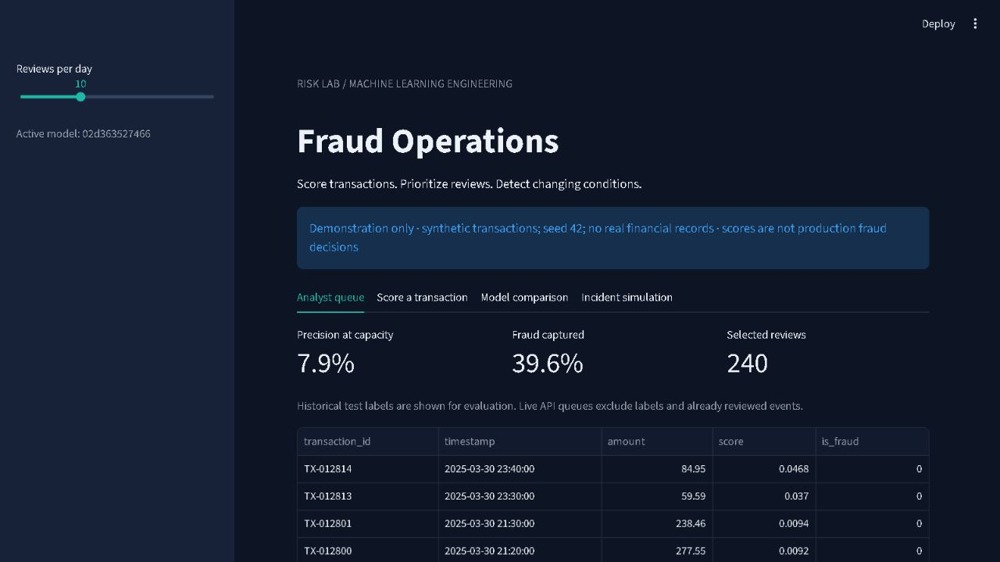
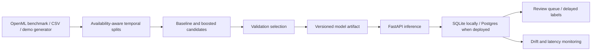

# Fraud Detection Platform

A reproducible fraud modelling and serving project with delayed-label temporal splits, an analyst queue, idempotent scoring, local event storage, drift monitoring and explicit model version activation.



## Run locally

Verified with Python 3.14:

```bash
python -m venv .venv
# Windows: .venv\Scripts\activate
# macOS/Linux: source .venv/bin/activate
pip install -r requirements.txt
python -m fraud.train
# Real public benchmark (download creditcard.arff from OpenML dataset 1597 first)
python -m fraud.train --openml-creditcard data/private/creditcard.arff
python -m pytest -q
streamlit run app.py
```

Start the service in another terminal:

```bash
uvicorn fraud.api:app --host 127.0.0.1 --port 8003
python -m fraud.replay --limit 200
python -m fraud.replay --limit 200 --incident
```

API documentation: `http://127.0.0.1:8003/docs`.

| Endpoint | Behaviour |
|---|---|
| `POST /predict` | Score and persist a transaction; exact retries return the original score |
| `POST /labels` | Record a delayed outcome; reject conflicting labels |
| `GET /queue?budget=10` | Highest-scoring unlabelled transactions received today (UTC) |
| `GET /monitor` | Recent event count, latency, label coverage and input PSI |
| `GET /health` | Active model version and readiness |

Example scoring payload:

```json
{"transaction_id":"DEMO-1","features":{"amount":240,"v1":0.1,"v2":-0.3,"v3":0.0,"v4":0.0,"v5":0.0,"v6":0.0,"v7":0.0,"v8":0.0,"v9":0.0,"v10":0.0,"v11":0.0,"v12":0.0,"v13":0.0,"v14":0.0,"v15":0.0,"v16":0.0,"v17":0.0,"v18":0.0,"v19":0.0,"v20":0.0,"v21":0.0,"v22":0.0,"v23":0.0,"v24":0.0,"v25":0.0,"v26":0.0,"v27":0.0,"v28":0.0}}
```

## Data and evaluation

The reproducible real-data path uses the anonymized **ULB/Worldline credit-card fraud benchmark** published as [OpenML dataset 1597](https://www.openml.org/d/1597). It contains 284,807 transactions, 492 fraud labels, Amount and anonymized PCA features V1–V28. Download its `creditcard.arff` file into `data/private/`, which Git ignores, then run the command above. Cite the dataset in any presentation or derivative work and check the source's current terms before redistributing data.

The source Time field is elapsed seconds, not a calendar date. This project supplies a fixed UTC origin only to make chronological splits and daily review capacity reproducible; it does not represent the original transaction dates. The three-hour label delay is also a modelling simulation because the benchmark spans only two days and has no observed label-arrival time. Scores are research demonstrations and must not be used for actual financial decisions.

The checked-in reference, schema and replay CSVs are bounded samples for quick local runs. Training regenerates them from the selected data source; raw benchmark data remains under the ignored `data/private/` directory.

Training uses the first 60% of time, validation the next 20%, and final testing the last 20%. Labels unavailable at the training or validation cutoff are excluded. Feature transforms are fit only on training data. All supplied features must be available at prediction time; the API assumes upstream feature computation, not a streaming feature store.

Logistic regression and histogram gradient boosting are compared. The active model is chosen using **validation average precision**, never final-test performance. Reports include average precision, ROC-AUC, Brier score and precision/recall at a daily review budget. Average precision is not identical to trapezoidal PR-AUC. See [results](reports/RESULTS.md) and [raw report](reports/evaluation.json).

## Architecture



`runtime/events.sqlite` is created automatically and ignored by Git for local development. Set `FRAUD_DB` to override the local database path. When `DATABASE_URL` is set, the API uses Postgres and creates the event table on first use. In `FRAUD_ENV=production`, the API refuses to fall back to ephemeral SQLite: configure a durable Postgres URL. The Vercel entrypoint is `index.py` (`index:app` in `pyproject.toml`). The small selected ULB model artifact is included so a fresh deployment serves the real benchmark model rather than silently switching to the synthetic demo. Runtime databases remain uncommitted. `python -m fraud.train` regenerates model artifacts.

The container uses a model artifact only when `artifacts/current.txt` points to an included `.joblib` file. Otherwise it trains the clearly labeled synthetic demo model. To containerize the ULB model, download the approved public data, train it locally, and build while the matching artifact and pointer are present; do not include private source data in the build context.

## API access control

Local development without a key is restricted to loopback clients. Before non-loopback or public serving, set `FRAUD_ENV=production` and provide a high-entropy `FRAUD_API_TOKEN` of at least 32 characters; protected endpoints require it in the `X-API-Key` header, and production mode fails closed when the token is missing or too short. The public `/health` endpoint only reports readiness and model version. Do not commit the token. The replay tool can read a key from an environment variable with `--api-key-env FRAUD_API_TOKEN` without printing it.

## Model versions and rollback

Training writes a versioned joblib artifact and updates `artifacts/current.txt`. Previous local artifacts are retained. To activate an existing version:

```bash
python -m fraud.registry VERSION
```

The API reads the pointer on requests and caches artifacts by version. Identical transaction retries preserve the original model score even after a version change. Promotion/rollback is a local CLI operation, not a public administration endpoint. Version IDs identify training data and selected model name; they are not a complete experiment registry or software provenance hash.

## Monitoring and limitations

The incident simulation increases Amount and shifts V1. PSI > 0.2 is a heuristic alert, not evidence of model failure. Monitoring waits for 100 events before returning PSI and never automatically retrains. Labelled metrics can be biased when only reviewed transactions receive outcomes. Replay can measure sequential and concurrent local HTTP latency. For example, run `python -m fraud.replay --limit 200 --concurrency 16` against the local API. The report includes throughput, p50/p95 latency, and errors. Results include client and network overhead and do not establish production capacity.

The dashboard's historical queue and interactive scoring run locally; the API's live queue is separate. For a hosted deployment, set `FRAUD_ENV=production`, a random `FRAUD_API_TOKEN` (at least 32 characters), and a persistent Postgres `DATABASE_URL`. The authenticated API supports multiple serverless instances through Postgres. Before removing Vercel SSO protection, add gateway rate limiting and monitor database operations and storage. Distributed feature computation, model governance, robust calibration and real-world validation are also still required before production decision use.

See [measured results](reports/RESULTS.md) for a reproducible ULB benchmark and a 1,000-request local API replay, including normal and shifted-input latency/error measurements. The hosted service is protected by Vercel SSO; no cloud inference performance or cost claim is made.

## Bring your own data

```bash
python -m fraud.train --csv data/private/transactions.csv
```

The schema is illustrated by `data/schema_example.csv`. Required fields are transaction_id, timestamp, label_available_at, is_fraud, amount and V1–V28-compatible numeric feature columns named `v1` through `v28`. At least 1,000 rows and both label classes in every temporal split are required. Keep private inputs in the ignored folder and review generated reports before publishing.

## Docker and checks

```bash
cp .env.example .env
# Set FRAUD_API_TOKEN in .env to a generated secret of at least 32 characters.
docker compose up --build -d
docker compose ps
```

Compose exposes the API on port 8003, uses a named volume for the SQLite event store, and checks `/health`. Keep `.env` private. The named volume survives container recreation on this host; it is not a backup and must be replaced with host-specific persistent storage for a cloud deployment.

```bash
docker build -t fraud-platform .
docker run --rm -p 8503:8501 fraud-platform
```

Tests cover temporal label availability, review budgets, drift, invalid data, idempotency, conflict handling, delayed outcomes and API validation. Never load untrusted joblib files.

Created with AI coding assistance. Reproduce the runs and understand the failure modes before presenting this work. MIT licensed; no source dataset is included in this repository.
